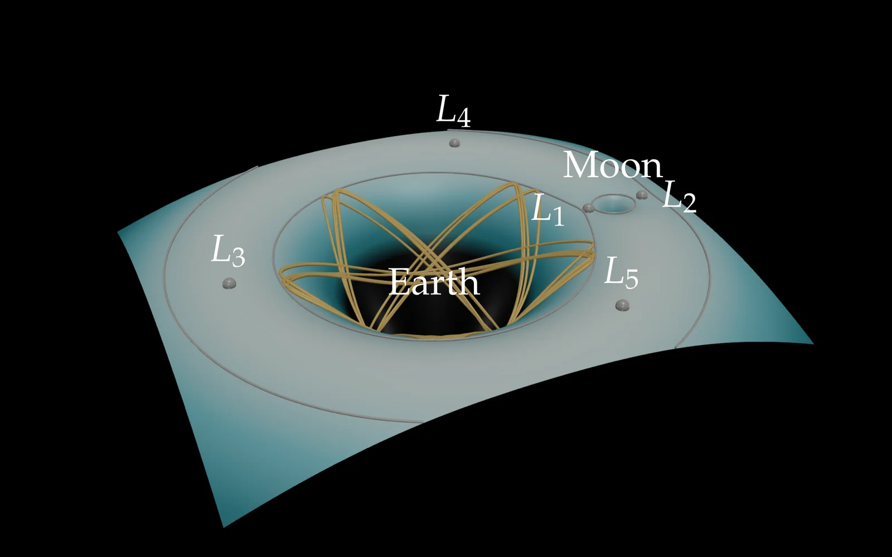

# Celestial dynamics

<p align="center">
  <a href="https://github.com/EngFlavioMartins/celestial-dynamics/actions/workflows/tests.yml"></a>
  <a href="https://doi.org/10.1590/1806-9126-rbef-2017-0174"></a>
  <a href="https://www.python.org/"></a>
  <a href="https://github.com/EngFlavioMartins/celestial-dynamics/blob/HEAD/LICENSE"></a>
  <a href="https://engflaviomartins.github.io/#celestial-dynamics"></a>
</p>

**Orbits, Lagrange points and Poincaré sections of the restricted three-body problem.**

<p align="center"></p>

A small Python exploration of the planar circular restricted three-body problem: trajectories in the rotating frame, the five Lagrange points, zero-velocity curves and Poincaré sections.

## Get started

```bash
git clone https://github.com/EngFlavioMartins/celestial-dynamics.git
cd celestial-dynamics
pip install -e .
celestial-dynamics
```

Open `outputs/demo/dynamics.png`. Try `celestial-dynamics --jacobi 3.1` for another energy level. The equations are in [docs/method.md](docs/method.md).

## Make the figure above

```bash
sh scripts/render/make_figure.sh
```

You need [ParaView](https://www.paraview.org/download/) (for `pvpython`), a LaTeX installation, and `pip install pyvista pillow`. The surface height is −log Ω, a display transform that keeps the wells, saddles and hills in place.

## Cite

This code accompanies the review below. If you use it, please cite:

```bibtex
@article{martins2018threebody,
  author  = {Martins, Flavio A. C. and Zanotello, M.},
  title   = {Mec{\^a}nica Celeste e a Teoria dos Sistemas Din{\^a}micos: Uma Revis{\~a}o do Problema Circular Restrito de Tr{\^e}s Corpos},
  journal = {Revista Brasileira de Ensino de F{\'\i}sica},
  volume  = {40},
  number  = {2},
  pages   = {e2310},
  year    = {2018},
  doi     = {10.1590/1806-9126-rbef-2017-0174}
}
```

GitHub's **Cite this repository** button (from [CITATION.cff](CITATION.cff)) gives the same reference in other formats.

## Licence

MIT; see [LICENSE](LICENSE). The bundled IBM Plex Sans fonts use the [SIL Open Font Licence](src/celestial_dynamics/fonts/OFL.txt).
